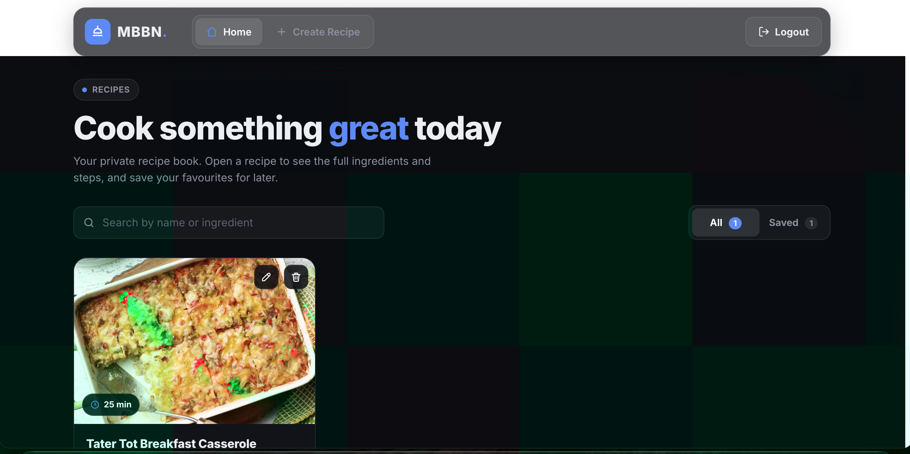
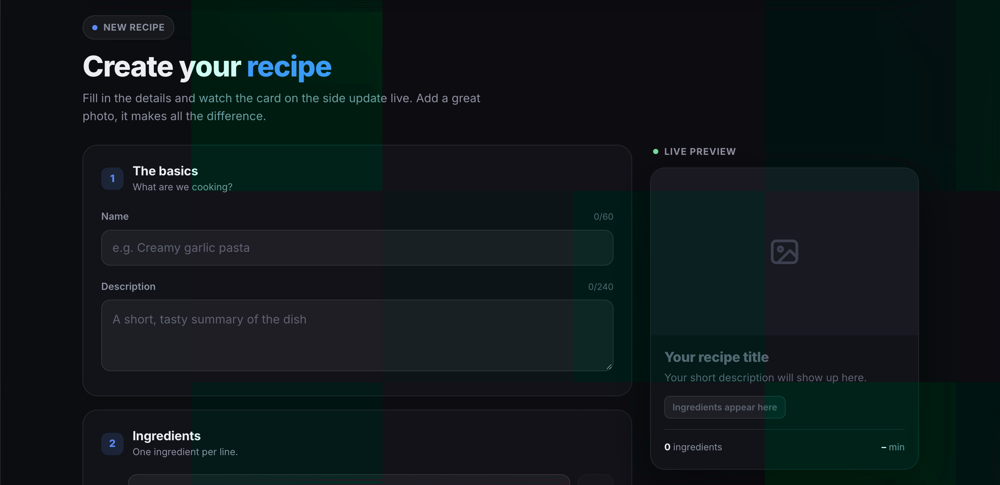
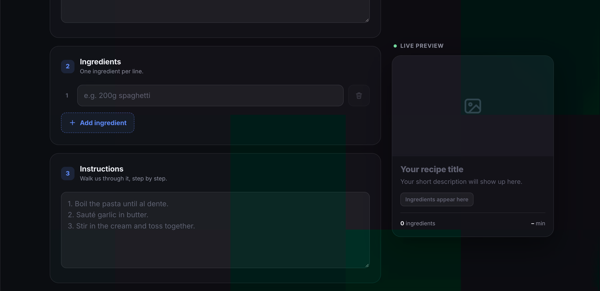
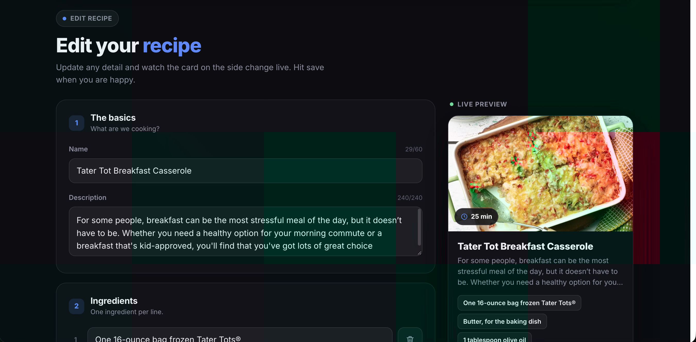
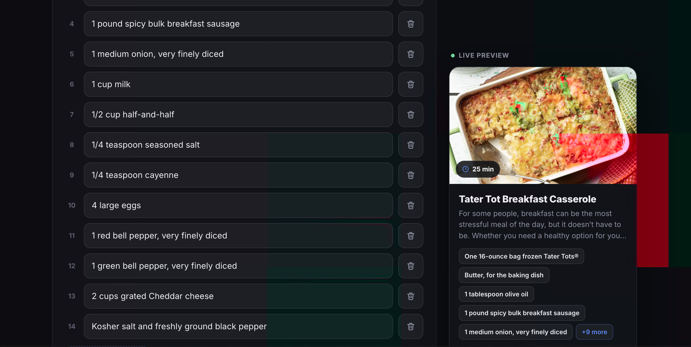
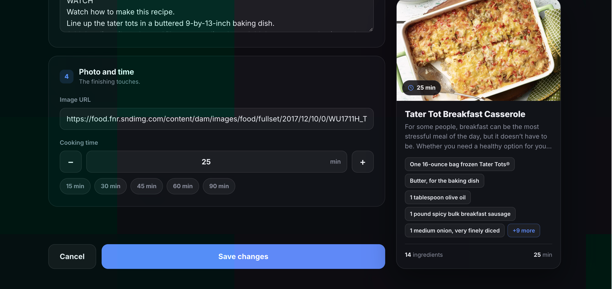
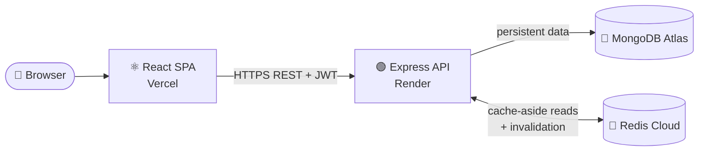
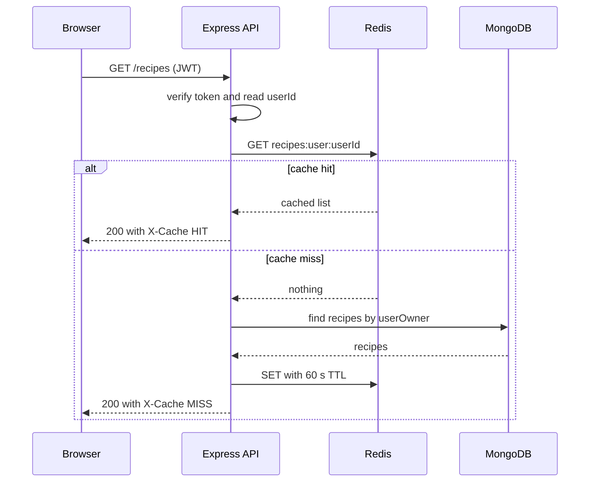
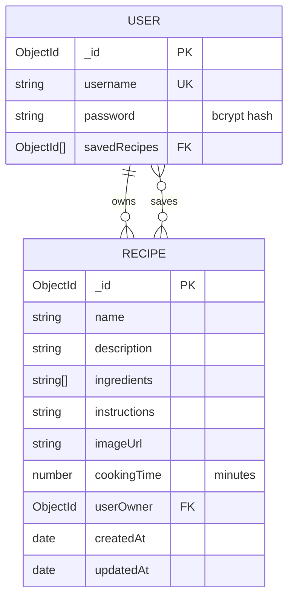
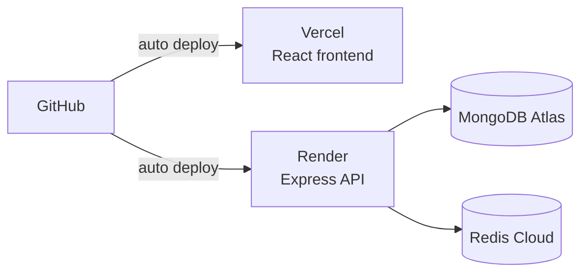

<div align="center">

# 🍽️ MERN Recipe App

**A production-deployed, full-stack recipe manager with JWT auth, owner-scoped access, rate limiting and Redis cache-aside caching.**

[](https://mern-recipe-info-manu-bharadwaj.vercel.app/)
[](https://manu-recipe-api.onrender.com/health)
[](https://github.com/Manu577228/Fullstack-6-series-2-MERN-Recipe-App)


[**Try it live**](https://mern-recipe-info-manu-bharadwaj.vercel.app/) · [**API health**](https://manu-recipe-api.onrender.com/health) · [**Architecture**](#️-architecture) · [**API reference**](#-api-reference)

</div>

---

## 📑 Table of contents

- [Overview](#-overview)
- [Try it in 60 seconds](#-try-it-in-60-seconds)
- [Features](#-features)
- [Screenshots](#️-screenshots)
- [Tech stack](#-tech-stack)
- [Architecture](#️-architecture)
- [Redis caching strategy](#-redis-caching-strategy)
- [Data model](#-data-model)
- [Engineering decisions](#-engineering-decisions)
- [Security](#-security)
- [Project structure](#-project-structure)
- [Run locally](#-run-locally)
- [API reference](#-api-reference)
- [Production deployment](#️-production-deployment)
- [Verify cache hits and load test](#-verify-cache-hits-and-load-test)
- [Troubleshooting](#-troubleshooting)
- [Roadmap](#️-roadmap)
- [Author](#-author)

---

## 📖 Overview

MERN Recipe App is a deployed full-stack application for creating and managing **personal, private recipe books**. Users register, log in, add recipes, edit or delete their own, and keep a saved-recipes list.

It goes well beyond basic CRUD:

- 🔐 **JWT authentication** with bcrypt-hashed passwords and expiring tokens
- 👤 **Owner-scoped access control** enforced on the server, never trusted from the client
- ✅ **Server-side validation** on every write
- 🚦 **Rate limiting**, **Helmet** security headers and request size limits
- ⚡ **Redis cache-aside caching** with TTLs, targeted invalidation, and graceful fallback to MongoDB
- ☁️ **Four independent managed services**: Vercel (UI), Render (API), MongoDB Atlas (data), Redis Cloud (cache)

---

## 🎯 Try it in 60 seconds

1. Open the **[live app](https://mern-recipe-info-manu-bharadwaj.vercel.app/)** and register with any username (3 to 40 characters) and a password (6 or more characters).
2. Click **Create Recipe**, fill in the form, and save it.
3. Back on **Home**, search for it, save it, edit it, then delete it.
4. Log out and log back in. Your recipes are still there.

> [!NOTE]
> The API runs on Render's free tier, which sleeps after 15 minutes without traffic. If the very first request takes around 50 seconds, that's the server waking up. After that it responds normally.

---

## ✨ Features

| | Feature | Details |
|---|---|---|
| 🔐 | **Authentication** | Register and log in, bcrypt hashing, JWT-protected routes, 7-day token lifetime, automatic logout on an expired session |
| 🥘 | **Recipe CRUD** | Name, description, ingredients, instructions, image URL and cooking time, with live form validation |
| 🔖 | **Saved recipes** | Save and unsave from your own collection, with a dedicated Saved tab |
| 👤 | **Per-user isolation** | Every read and mutation is restricted to the authenticated owner |
| ⚡ | **Redis caching** | Cache-aside reads for lists and single recipes, with TTLs and invalidation on every change |
| 🛡️ | **API protections** | Helmet, CORS allow-list, auth rate limiting, 100 KB body limit, strict validation |
| 📱 | **Responsive UI** | React Router with protected and guest-only routes, mobile menu, loading, empty and error states |
| ☁️ | **Production-ready** | Independently deployed frontend and backend, health check endpoint, all secrets in environment variables |

---

## 🖼️ Screenshots

<!-- Check the file extensions below match the files in the repo (.PNG vs .png) -->
<table>
  <tr>
    <td></td>
    <td></td>
    <td></td>
  </tr>
  <tr>
    <td></td>
    <td></td>
    <td></td>
  </tr>
  <tr>
    <td></td>
    <td></td>
    <td></td>
  </tr>
</table>

---

## 🧰 Tech stack

| Layer | Technologies |
|---|---|
| **Frontend** | React 18, Create React App, React Router 6, Axios, React Bootstrap, Bootstrap, Tailwind CSS |
| **Backend** | Node.js, Express.js, Mongoose |
| **Database** | MongoDB Atlas |
| **Cache** | Redis Cloud, `redis` (node-redis client) |
| **Auth** | JSON Web Tokens, bcrypt |
| **Security** | Helmet, CORS, express-rate-limit |
| **Hosting** | Vercel (frontend), Render (backend) |
| **Tooling** | Git, GitHub, k6 (load testing) |

---

## 🏗️ Architecture



**How a request flows**

1. The user registers or logs in through the React frontend.
2. The API validates credentials and returns a signed JWT.
3. The frontend sends the token in the `Authorization` header on every protected call.
4. The API verifies the token and uses the **user id inside it** to enforce ownership.
5. For supported `GET` requests it checks Redis first. On a miss it queries MongoDB and caches the result.
6. Creating, editing or deleting a recipe invalidates the affected cache entries, so the next read is fresh.

---

## ⚡ Redis caching strategy

| Resource | Cache key | TTL |
|---|---|---|
| Authenticated user's recipe list | `recipes:user:<userId>` | 60 s |
| Individual recipe | `recipe:<recipeId>` | 300 s |



- **Hit:** return cached data and set `X-Cache: HIT`.
- **Miss:** query MongoDB, populate Redis, set `X-Cache: MISS`.
- **Create:** invalidate the owner's list cache.
- **Update or delete:** invalidate the owner's list cache **and** that recipe's cache.
- **Ownership:** checked even when serving a cached single recipe, because the cache is shared.
- **Resilience:** Redis is an optimisation, never a dependency. If `REDIS_URL` is missing or Redis goes down, every call silently falls back to MongoDB, the source of truth.

---

## 🗃️ Data model



`userOwner` is indexed because every list query filters on it.

---

## 🧠 Engineering decisions

| Decision | Why |
|---|---|
| **Owner comes from the JWT, never the request body** | A client can't create or claim recipes for someone else by sending a different id. |
| **Someone else's recipe returns `404`, not `403`** | Ids can't be probed to discover which recipes exist. |
| **`401` for any bad token, `403` only for "not yours"** | The frontend treats `401` as "log out and re-authenticate", so an expired session never leaves the user stuck. |
| **Cache-aside with targeted invalidation** | Simple to reason about, and writes only evict the keys they affect. |
| **Redis failures never fail a request** | All cache calls are best-effort. Losing the cache costs speed, not availability. |
| **Redis is optional** | Local development needs only Node and MongoDB. |
| **Secrets only from environment variables** | The server refuses to start without `MONGO_URI` and `JWT_SECRET`. |
| **Connect to MongoDB before listening** | The API never accepts traffic it can't serve. |
| **Whitelisted fields on every write** | Only known recipe fields can ever be stored (no mass assignment). |
| **`$addToSet` for saving recipes** | Saving twice can never create duplicates. |

---

## 🔒 Security

- Passwords hashed with **bcrypt** (10 rounds) before storage. Passwords are never logged or returned.
- **JWTs** are signed with a server-side secret, restricted to HS256, and expire after 7 days.
- **Rate limiting** on `/auth`: 50 requests per 15 minutes per IP.
- **Helmet** security headers and a **100 KB** request body limit.
- **CORS** restricted to the deployed frontend via `CLIENT_ORIGIN`.
- **Server-side validation** on all writes:

| Field | Rule |
|---|---|
| Username | 3 to 40 characters |
| Password | 6 to 72 characters |
| Recipe name | required, up to 60 characters |
| Description | up to 240 characters |
| Ingredients | 1 to 50 items, up to 200 characters each |
| Instructions | required, up to 5000 characters |
| Image URL | must start with `http://` or `https://` |
| Cooking time | whole minutes, 1 to 1440 |

- Recipe ids are validated before any database query.
- Never commit `.env` files, credentials or JWTs.

> [!IMPORTANT]
> Older Git history may contain previously committed environment files. Rotate any exposed credentials. Deleting a file in the latest commit does not remove it from history.

---

## 📂 Project structure

```text
Fullstack-6-series-2-MERN-Recipe-App/
├── recipe-app-frontend/
│   ├── public/
│   ├── src/
│   │   ├── components/
│   │   │   └── Navbar.js
│   │   ├── hooks/
│   │   │   ├── useGetUserID.js
│   │   │   └── useLogout.js
│   │   ├── pages/
│   │   │   ├── Auth.js
│   │   │   ├── CreateRecipe.js
│   │   │   └── Home.js
│   │   ├── App.js
│   │   └── config.js
│   └── package.json
├── recipe-app-backend/
│   ├── src/
│   │   ├── config/
│   │   │   └── redis.js
│   │   ├── models/
│   │   │   ├── Recipes.js
│   │   │   └── Users.js
│   │   ├── routes/
│   │   │   ├── Users.js
│   │   │   └── recipes.js
│   │   └── index.js
│   └── package.json
├── k6-loadtest.js
├── Sample-UI-1.PNG ... Sample-UI-9.png
├── DEPLOYMENT.md
├── render.yaml
└── README.md
```

---

## 🚀 Run locally

**Prerequisites:** Node.js and npm, a MongoDB connection string (local or Atlas), and optionally a Redis server.

### 1. Clone

```bash
git clone https://github.com/Manu577228/Fullstack-6-series-2-MERN-Recipe-App.git
cd Fullstack-6-series-2-MERN-Recipe-App
```

### 2. Backend

```bash
cd recipe-app-backend
npm ci
```

Create `recipe-app-backend/.env`:

```env
PORT=3001
NODE_ENV=development
MONGO_URI=mongodb+srv://<username>:<password>@<cluster-host>/<database>?retryWrites=true&w=majority
JWT_SECRET=replace-with-a-long-random-secret
REDIS_URL=redis://localhost:6379
CLIENT_ORIGIN=http://localhost:3000
```

| Variable | Required | Notes |
|---|---|---|
| `MONGO_URI` | ✅ | Include the database name before the `?`. No quotes or `< >` brackets. |
| `JWT_SECRET` | ✅ | Generate one: `node -e "console.log(require('crypto').randomBytes(48).toString('hex'))"` |
| `PORT` | | Defaults to `3001`. |
| `CLIENT_ORIGIN` | | Frontend URL(s), comma separated. Leave empty locally to allow any origin. |
| `REDIS_URL` | | Optional. Without it the API runs without a cache. |

```bash
npm run dev
```

The API starts at `http://localhost:3001`. You should see `MongoDB connected` and `Server started on port 3001`.

### 3. Frontend

In another terminal:

```bash
cd recipe-app-frontend
npm ci
npm start
```

Open `http://localhost:3000`. With no frontend `.env`, the app talks to `http://localhost:3001` automatically. To point at another backend, create `recipe-app-frontend/.env`:

```env
REACT_APP_API_URL=http://localhost:3001
```

> The frontend uses Create React App, not Vite. Variables exposed to browser code must start with `REACT_APP_`, and they are read at startup, so restart `npm start` after changing them.

---

## 📡 API reference

**Production API:** `https://manu-recipe-api.onrender.com`

### Public endpoints

| Method | Endpoint | Description |
|---|---|---|
| `GET` | `/health` | API health check |
| `POST` | `/auth/register` | Register an account |
| `POST` | `/auth/login` | Authenticate and receive a JWT |

### Protected endpoints

Send `Authorization: Bearer <token>` with these requests.

| Method | Endpoint | Description |
|---|---|---|
| `GET` | `/recipes` | List the authenticated user's recipes |
| `POST` | `/recipes` | Create a recipe |
| `GET` | `/recipes/:recipeId` | Get one owned recipe |
| `PUT` | `/recipes/:recipeId` | Update an owned recipe |
| `DELETE` | `/recipes/:recipeId` | Delete an owned recipe |
| `PUT` | `/recipes` | Save a recipe (`{ "recipeID": "..." }`) |
| `DELETE` | `/recipes/saved/:recipeId` | Unsave a recipe |
| `GET` | `/recipes/savedRecipes/ids/:userId` | List saved recipe ids |
| `GET` | `/recipes/savedRecipes/:userId` | Retrieve saved recipe documents |

> Saved recipes are restricted to recipes owned by the authenticated user in the current implementation.

### Status codes

| Code | Meaning |
|---|---|
| `200` / `201` | Success / created |
| `400` | Validation failed. The body has a readable `message`. |
| `401` | Missing, invalid or expired token. The frontend logs the user out. |
| `403` | Logged in, but asking for another user's saved list |
| `404` | Recipe doesn't exist **or isn't yours** |
| `429` | Too many auth attempts, try again in a few minutes |
| `500` | Unexpected server error |

<details>
<summary><b>📋 Request examples (click to expand)</b></summary>

**Register**

```bash
curl -X POST https://manu-recipe-api.onrender.com/auth/register \
  -H 'Content-Type: application/json' \
  -d '{"username":"example_user","password":"choose-a-strong-password"}'
```

**Log in** (returns `token` and `userID`)

```bash
curl -X POST https://manu-recipe-api.onrender.com/auth/login \
  -H 'Content-Type: application/json' \
  -d '{"username":"example_user","password":"choose-a-strong-password"}'
```

**Fetch recipes**

```bash
curl https://manu-recipe-api.onrender.com/recipes \
  -H 'Authorization: Bearer YOUR_JWT_TOKEN'
```

**Create a recipe**

```bash
curl -X POST https://manu-recipe-api.onrender.com/recipes \
  -H 'Content-Type: application/json' \
  -H 'Authorization: Bearer YOUR_JWT_TOKEN' \
  -d '{
    "name": "Pasta Primavera",
    "description": "Quick vegetable pasta",
    "ingredients": ["Pasta", "Tomatoes", "Olive oil"],
    "instructions": "Cook pasta, sauté vegetables, and combine.",
    "imageUrl": "https://example.com/pasta.jpg",
    "cookingTime": 25
  }'
```

</details>

---

## ☁️ Production deployment



### Frontend: Vercel

| Setting | Value |
|---|---|
| Root directory | `recipe-app-frontend` |
| Framework | Create React App |
| Build command | `npm run build` |
| Output directory | `build` |
| Environment variable | `REACT_APP_API_URL=https://manu-recipe-api.onrender.com` |

Live frontend: <https://mern-recipe-info-manu-bharadwaj.vercel.app/>

The API URL is embedded at build time, so changing `REACT_APP_API_URL` requires a redeploy. A rewrite to `index.html` keeps deep links such as `/create-recipe` working on refresh.

### Backend: Render

| Setting | Value |
|---|---|
| Root directory | `recipe-app-backend` |
| Build command | `npm ci` |
| Start command | `npm run start:prod` |
| Health endpoint | `/health` |

| Environment variable | Purpose |
|---|---|
| `MONGO_URI` | MongoDB Atlas connection string |
| `JWT_SECRET` | Secret for signing and verifying JWTs |
| `REDIS_URL` | Redis Cloud connection URL |
| `CLIENT_ORIGIN` | Allowed frontend origin, e.g. `https://mern-recipe-info-manu-bharadwaj.vercel.app` |
| `NODE_ENV` | `production` |

Live backend: <https://manu-recipe-api.onrender.com>

> `render.yaml` and `DEPLOYMENT.md` are kept for reference. The live setup is Vercel + Render + MongoDB Atlas + Redis Cloud. The Render Blueprint describes a different, Render-hosted frontend and cache option.

---

## 🔍 Verify cache hits and load test

### Check Redis is working

```bash
TOKEN='YOUR_JWT_TOKEN'

curl -s -D - -o /dev/null \
  -H "Authorization: Bearer $TOKEN" \
  https://manu-recipe-api.onrender.com/recipes \
  | grep -iE '^(HTTP/|x-cache:)'
```

Run it twice. The first call returns `x-cache: MISS`, the second `x-cache: HIT`. A miss again is expected after the entry expires or a recipe changes.

### Load test with k6

The repo includes a read-only [k6](https://k6.io) script that ramps to 10 virtual users and asserts under 1% errors and a p95 under 800 ms.

```bash
brew install k6

# against a local API
k6 run -e BASE_URL=http://localhost:3001 k6-loadtest.js

# against production (keep the load gentle on free tiers)
k6 run -e BASE_URL=https://manu-recipe-api.onrender.com k6-loadtest.js
```

It signs in once, because `/auth` is rate limited, so a test that logged in on every iteration would only measure the limiter.

---

## 🩺 Troubleshooting

<details>
<summary><b>Click to expand common problems</b></summary>

| Symptom | Likely cause and fix |
|---|---|
| `Missing MONGO_URI or JWT_SECRET` | `.env` is missing, in the wrong folder, or misnamed. It must be `recipe-app-backend/.env`, next to `package.json`. |
| `Could not connect to MongoDB: bad auth` | Wrong password, brackets left around it, or an unencoded special character. URL-encode symbols (`@` becomes `%40`) or use a letters-and-numbers password. |
| `Invalid scheme, expected connection string to start with "mongodb://"` | The value is malformed, often `MONGO_URI=MONGO_URI=...` pasted twice, or quotes around it. |
| Connection timeout to Atlas | Your IP isn't allowed. In Atlas, open Network Access and add your IP, or `0.0.0.0/0` for a hosted API. |
| Frontend shows "An error occurred. Please try again." | The frontend is calling the wrong URL. Check `REACT_APP_API_URL`, then restart `npm start`. |
| CORS error in the browser console | `CLIENT_ORIGIN` doesn't exactly match the frontend URL (no trailing slash). Leave it empty for local development. |
| First request takes about 50 seconds | Render's free tier is waking from sleep. This is normal. |
| Logged out unexpectedly | The 7-day token expired. Log in again. |
| `x-cache` header always `MISS` | `REDIS_URL` isn't set or Redis is unreachable. Check the server logs for `Redis connected`. |

</details>

---

## 🛣️ Roadmap

- [ ] Automated backend and frontend tests with CI checks
- [ ] Resolve ESLint warnings and dependency audit findings
- [ ] Pagination, search and recipe filters
- [ ] Image uploads instead of requiring image URLs
- [ ] Stronger session management with refresh tokens
- [ ] Observability and deployment health monitoring

---

## 👨‍💻 Author

**Manu Bharadwaj**

[](https://github.com/Manu577228)
[](https://youtube.com/@code-with-Bharadwaj)
<!-- Add your LinkedIn: [](https://www.linkedin.com/in/YOUR-HANDLE) -->

If you found this project useful, consider giving the repository a ⭐

<div align="center">

Built with React, Express, MongoDB and Redis, deployed on Vercel and Render.

</div>
